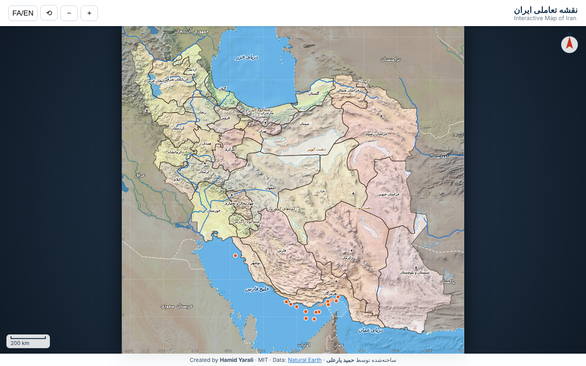
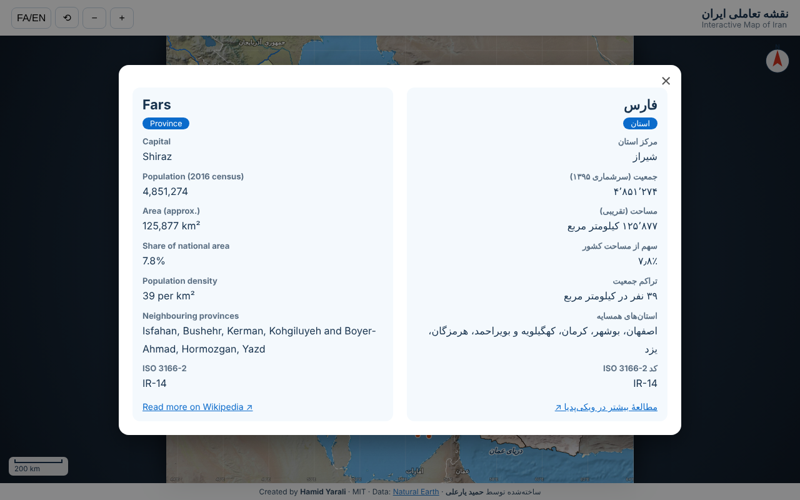

<div align="center">

# 🗺️ نقشه تعاملی ایران · Interactive Map of Iran

**[فارسی](#فارسی) · [English](#english)**



</div>

---

## فارسی

نقشهٔ تعاملی و بدون وابستگی (Vanilla JS + SVG) از **۳۱ استان ایران**، **دریای خزر، خلیج فارس، تنگهٔ هرمز، دریای عمان**، دریاچهٔ ارومیه، **جزایر** و **رودهای** اصلی. روی هر بخش کلیک کنید تا مشخصات آن به‌صورت **دوزبانهٔ فارسی و انگلیسی** در یک مودال نمایش داده شود.



### ویژگی‌ها
- نقشهٔ ناهمواری واقعی (شیب‌نمایی) با مرز استان‌ها، شبکهٔ مختصات، قطب‌نما و خط مقیاس
- مودال دوزبانه: مرکز استان، جمعیت (سرشماری ۱۳۹۵)، مساحت، سهم از مساحت کشور، تراکم، استان‌های همسایه (محاسبه‌شده از هندسهٔ نقشه) و پیوند به ویکی‌پدیا
- دریاها، تنگهٔ هرمز، دریاچه‌ها و تالاب‌های شور، ۱۳ جزیره (با شکل واقعی در صورت وجود)، ۱۲ رود، رشته‌کوه‌ها (زاگرس، البرز، کپه‌داغ و…)، کویرها (دشت کویر و دشت لوت) و ۱۲ قلهٔ مهم از جمله دماوند
- زوم با چرخ ماوس، کشیدن (Pan)، دکمه‌های زوم و تغییر زبان برچسب‌ها (FA/EN)

### اجرا
```bash
git clone https://github.com/<your-username>/iran-interactive-map.git
cd iran-interactive-map
# فایل index.html را باز کنید، یا:
python3 -m http.server 8000   # سپس http://localhost:8000
```
برای انتشار روی **GitHub Pages**: Settings ← Pages ← شاخهٔ `main` و پوشهٔ root.

### ساختار پروژه
| مسیر | توضیح |
|---|---|
| `index.html`, `style.css`, `app.js` | رابط کاربری و منطق نقشه |
| `data/info.js` | اطلاعات دستی (استان‌ها، دریاها، جزایر، رودها) — برای افزودن مورد جدید همین‌جا ویرایش کنید |
| `data/geo.js` | مسیرهای SVG تولیدشده از Natural Earth |
| `data/relief.jpg` | تصویر ناهمواری ایران (مرکاتور) |
| `tools/build_geo.py`, `tools/make_relief.py` | بازتولید `geo.js` و `relief.jpg` |

### نکته‌ها
- مرزها از [Natural Earth](https://www.naturalearthdata.com/) (دامنهٔ عمومی) است؛ مساحت‌ها از روی همین هندسه محاسبه شده و **تقریبی** است. جمعیت‌ها تقریبی و از سرشماری ۱۳۹۵ است.
- مسیر رودهای کارون، زاینده‌رود و دز **شماتیک** است؛ دریاچه‌های شور و تنگهٔ هرمز هم تقریبی ترسیم شده‌اند. پس‌زمینه تصویر ناهمواری واقعی [Natural Earth I](https://www.naturalearthdata.com/) (دامنهٔ عمومی، حدود ۱٫۸ کیلومتر در هر پیکسل) است و در زوم‌های خیلی زیاد تار می‌شود. جزایر، رودها و قله‌ها در `data/info.js` قابل گسترش‌اند.
- مشارکت (Pull Request) برای تکمیل اطلاعات و افزودن جزایر و رودهای بیشتر پذیرفته می‌شود.

---

## English

A dependency-free (Vanilla JS + SVG) interactive map of Iran's **31 provinces**, the **Caspian Sea, Persian Gulf, Strait of Hormuz, Gulf of Oman**, Lake Urmia, major **islands** and **rivers**. Click any feature to open a **bilingual (Persian / English)** details modal.

### Features
- Real shaded-relief basemap with province borders, graticule, compass and scale bar
- Bilingual modal: capital, population (2016 census), area, share of national area, density, neighbouring provinces (computed from the geometry) and a Wikipedia link
- Seas, the Strait of Hormuz, salt lakes and wetlands, 13 islands (real outlines where available), 12 rivers, mountain ranges (Zagros, Alborz, Kopet Dag…), deserts (Kavir and Lut) and 12 notable peaks including Damavand
- Mouse-wheel zoom, drag to pan, zoom buttons and label-language toggle (FA/EN)

### Run
```bash
git clone https://github.com/<your-username>/iran-interactive-map.git
cd iran-interactive-map
# open index.html, or:
python3 -m http.server 8000   # then visit http://localhost:8000
```
Deploy on **GitHub Pages**: Settings → Pages → branch `main`, root folder.

### Project structure
| Path | Description |
|---|---|
| `index.html`, `style.css`, `app.js` | UI and map logic |
| `data/info.js` | Hand-written reference data — edit here to add features |
| `data/geo.js` | SVG paths generated from Natural Earth |
| `data/relief.jpg` | Mercator shaded-relief image of Iran |
| `tools/build_geo.py`, `tools/make_relief.py` | Regenerate `geo.js` and `relief.jpg` |

### Notes
- Geometry comes from [Natural Earth](https://www.naturalearthdata.com/) (public domain); areas are computed from it and are **approximate**. Populations are approximate 2016-census figures.
- The Karun, Zayandeh Rud and Dez courses are **schematic**; the salt lakes and the Strait of Hormuz are approximate. The background is real shaded relief from [Natural Earth I](https://www.naturalearthdata.com/) (public domain, ~1.8 km per pixel), so it softens at very high zoom. Islands, rivers and peaks can be extended in `data/info.js`.
- Pull requests that add islands, rivers or more details are welcome.

---

## 👤 Author · سازنده
**حمید یارعلی · Hamid Yarali**

## 📄 License · مجوز
[MIT](LICENSE) © 2026 Hamid Yarali
